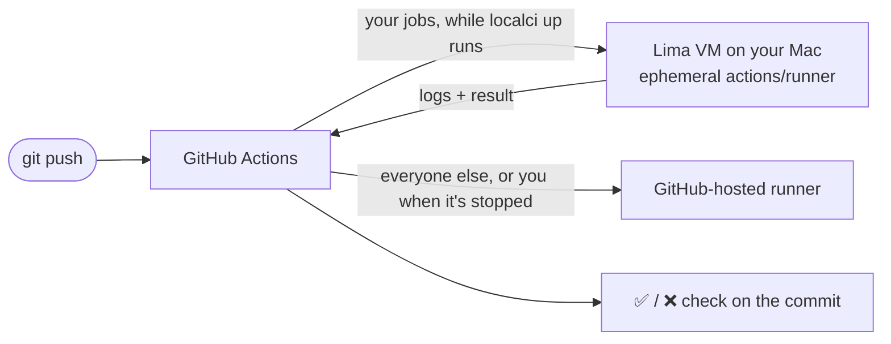

# LocalCI

Run your existing GitHub Actions jobs on your own Apple Silicon Mac and get the same green or red check on GitHub.



GitHub still dispatches the job and produces the check. LocalCI only provides the machine, so branch protection behaves as usual.

**Status:** Phase 1 works end to end (push, PRs, `services:`, parallel jobs, hosted fallback). See [progress](docs/progress.md).

## Get started

You need a Mac with Apple Silicon and **admin** on the repo you want to run jobs for.

**1. Install and build** (once)

```sh
brew install go lima gh
gh auth login
git clone git@github.com:TeepLabs/localci.git && cd localci
make build                  # → bin/localci
bin/localci setup           # creates the VM, installs the runner and Docker (a few minutes the first time)
```

**2. Try it on the bench repo**

```sh
bin/localci up -repo TeepLabs/localci-bench       # leave it running
```

In a second terminal:

```sh
gh workflow run go-cpu.yml -R TeepLabs/localci-bench
gh run watch -R TeepLabs/localci-bench            # pick the run
```

The job's runner name starts with `localci-<your login>`. To see a red check, clone `localci-bench`, change `want` to 5 in `cases/go-cpu/hello_test.go` and push.

**3. Stop**

Ctrl-C. Your runner is removed and your jobs go back to GitHub-hosted runners.

## Use it on your own repo

Change `runs-on` on each job that may run locally:

```yaml
runs-on: ${{ fromJSON(vars.LOCALCI_RUNNERS || '{}')[github.actor] || 'ubuntu-latest' }}
```

Then `bin/localci up -repo owner/name`. Add `-runners 2` to run two jobs at once. `localci up` adds you to the `LOCALCI_RUNNERS` repo variable while it runs, so only your jobs come to your Mac.

Don't add the line to jobs that use secrets or deploy. Those stay on hosted runners until Phase 2.

## Troubleshooting

| Symptom | Fix |
|---|---|
| `runner not installed in VM` | `bin/localci setup` |
| `HTTP 403` from `generate-jitconfig` | You need admin on the repo |
| Your job sits in `queued` | Is `localci up` running and awake? If it was killed with `kill -9`, start it again, or remove yourself from `LOCALCI_RUNNERS` |
| A tool is missing in the job | The VM is ARM64 Ubuntu, not GitHub's image. Install the tool in a step, or use a `setup-*` action |

## Working on LocalCI

```sh
make check            # vet, tests, gofmt (CI runs this plus golangci-lint and shellcheck)
golangci-lint run
```

Read [AGENTS.md](AGENTS.md) for conventions, and [progress](docs/progress.md) for what's next.

## Benchmark (one sample, CPU-bound Go tests)

| | Job | `go test` |
|---|---|---|
| GitHub-hosted (2 vCPU x86) | 57s | 40s |
| LocalCI cold (4 vCPU ARM64 VM) | 42s | 17s |
| LocalCI warm | 24s | 19s |

Details are in [research 002](docs/research/002-phase1-validation.md).

## Docs

- [Architecture](docs/architecture.md): components, job lifecycle, routing
- [Security](docs/security.md): what a local check does and doesn't prove
- [Roadmap](docs/roadmap.md) and [progress](docs/progress.md)
- [Decisions](docs/decisions/) and [research](docs/research/)
- [Product brief](docs/brief.md)

## Limitations

- Each job needs the one-line `runs-on` change.
- If your Mac sleeps, or `localci up` is killed uncleanly, your jobs wait until it's back (up to 24h).
- ARM64 only: amd64-only images and tools don't work.
- A local green check is your Mac's word, not proof ([security](docs/security.md)).

The full list is in [AGENTS.md](AGENTS.md#known-limitations).
