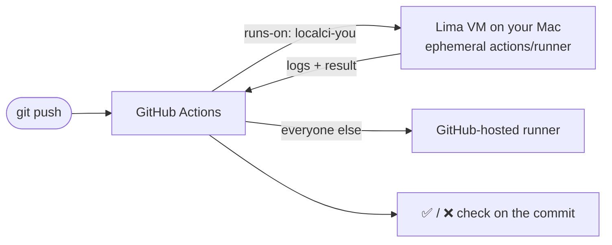

# LocalCI

Run your existing GitHub Actions jobs on your own Apple Silicon Mac and get the same green or red check on GitHub.

Laptops often have more compute than GitHub-hosted runners, but every push still re-runs CI remotely. LocalCI routes your own jobs to an ephemeral GitHub self-hosted runner inside a local Linux VM. GitHub dispatches the job, the runner executes it on the exact commit, and the check comes from GitHub Actions itself, so branch protection behaves as usual.



**Status:** Phase 1 proof of concept. It works end to end for push and PR events. Runs one job at a time by default, or N with `-runners N`. See the [progress log](docs/progress.md).

## Quick start

Requires macOS on Apple Silicon, Go, [Lima](https://lima-vm.io) 2.x and the [GitHub CLI](https://cli.github.com) with admin on the target repo.

```sh
make build
bin/localci setup                             # one-time: VM + runner
bin/localci up -repo owner/name -label localci-$(gh api user --jq .login)
```

In the target repo, change each job's `runs-on` and set one repo variable:

```yaml
runs-on: ${{ fromJSON(vars.LOCALCI_RUNNERS || '{}')[github.actor] || 'ubuntu-latest' }}
```

```sh
gh variable set LOCALCI_RUNNERS -R owner/name --body '{"your-login":"localci-your-login"}'
```

Jobs from people not in the map, including fork PRs, keep running on GitHub-hosted runners.

## Benchmark (single sample, CPU-bound Go tests)

| | Job | `go test` |
|---|---|---|
| GitHub-hosted (2 vCPU x86) | 57s | 40s |
| LocalCI cold (4 vCPU ARM64 VM) | 42s | 17s |
| LocalCI warm | 24s | 19s |

Details are in [research 002](docs/research/002-phase1-validation.md). Test cases and results live in [`TeepLabs/localci-bench`](https://github.com/TeepLabs/localci-bench).

## Documentation

- [Architecture](docs/architecture.md): components, job lifecycle, routing (with diagrams)
- [Security](docs/security.md): threat model and what is **not** guaranteed
- [Roadmap](docs/roadmap.md): the four phases (work, secure, zero-trust, fast)
- [Progress log](docs/progress.md): current state and next tasks
- [Decisions](docs/decisions/): ADRs
- [Research](docs/research/): platform facts, spike, validation
- [AGENTS.md](AGENTS.md): conventions and commands for contributors and coding agents
- [Product brief](docs/brief.md)

## Limitations

These are the important ones; the full list is in [AGENTS.md](AGENTS.md#known-limitations).

- Needs a one-line `runs-on` change per job. GitHub has no transparent redirection.
- The laptop must be awake and online. Otherwise routed jobs wait in the queue for up to 24h.
- Docker works in the VM (`services:` verified). Images must have ARM64 builds.
- A local green check is the developer's word, not proof (see [security](docs/security.md)).
