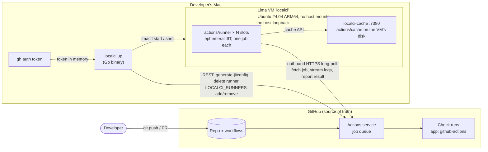
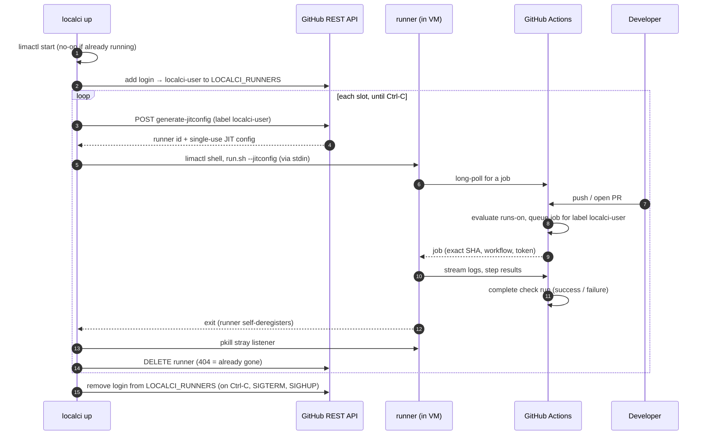
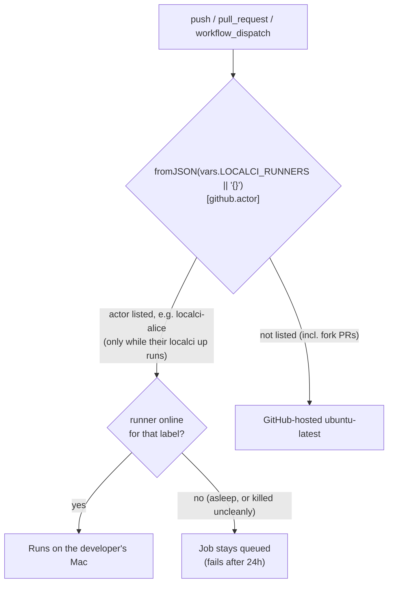
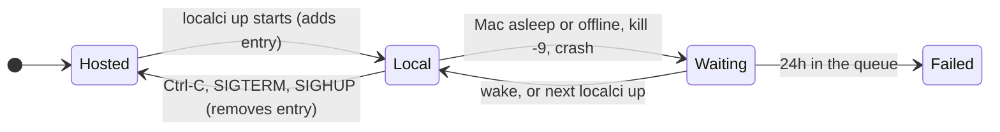

# Architecture

## Phase 1: components



| Concern | Owner |
|---|---|
| Event detection, job dispatch, commit identity | GitHub Actions (runner long-poll) |
| Workflow parsing and execution | official `actions/runner` |
| Check status and logs | GitHub Actions (the job's own check run) |
| VM lifecycle, runner registration loop, routing on/off | `localci` (`internal/runner`) |
| GitHub API calls | `localci` (`internal/github`) |
| `actions/cache` storage | `localci-cache` in the VM (`internal/cache`); artifacts are forwarded to GitHub ([research 006](research/006-local-actions-cache.md)) |
| Auth | `GH_TOKEN` or `gh auth token` (repo admin, [ADR 0002](decisions/0002-repo-admin.md)), in memory only |

Everything goes over outbound HTTPS. There are no inbound ports, no webhooks and no LocalCI backend.

## Job lifecycle



With `-runners N`, N slots run this loop at once. Each slot has its own runner directory in the VM (`~/actions-runner`, `~/actions-runner-2`, …), because a runner keeps its credentials and `_work` there.

### How the work reaches the VM

`localci` never watches pushes and never touches code. GitHub decides which jobs go to which runner, and the runner in the VM fetches everything else itself:

| What | How it gets there | Where it lives in the VM |
|---|---|---|
| Job definition | Part of the job message: steps already parsed from the YAML, the SHA, variables, the secrets the job references, a short-lived `GITHUB_TOKEN` scoped to the repo and run | runner memory |
| Actions (`uses:`) | Downloaded by the runner, pinned to a commit (`Download action repository …` in the job log) | `~/actions-runner/_work/_actions` |
| Source code | The `actions/checkout` step fetches the exact SHA using `GITHUB_TOKEN`. Without that step there is no code | `~/actions-runner/_work/<repo>/<repo>` |
| Toolchain | `setup-go` and similar actions download it | `~/actions-runner/_work/_tool`, kept between jobs (the warm-run speedup) |
| Results | The runner streams the log, and the step's exit code decides whether the check is green or red | — |

`localci` only fetches the JIT registration config and passes it to the runner through stdin. The VM has no host mounts, so files on the Mac never take part.

## Routing



`runs-on` is evaluated when the job is queued. Opt-in jobs use:

```yaml
runs-on: ${{ fromJSON(vars.LOCALCI_RUNNERS || '{}')[github.actor] || 'ubuntu-latest' }}
```

`LOCALCI_RUNNERS` maps a GitHub login to a runner label, for example `{"alice":"localci-alice"}`. `localci up` manages its user's entry. Each job runs exactly once, on a hosted or a local runner, so duplicate checks can't happen.

For `pull_request`, the runner tests GitHub's merge ref (`refs/pull/N/merge`), and the check appears on the PR head SHA. That's the same as hosted runners (research 002).

## Failure behaviour

Where a user's jobs go, depending on what `localci up` is doing:



| Event | What happens |
|---|---|
| Short sleep or network drop | Recovers on its own. The runner reconnects, or GitHub drops it and `localci` registers a new one. Queued jobs run after wake ([research 004](research/004-sleep-and-network.md)) |
| Network drop mid-job | The job fails if a step needs the network (including the runner's `docker pull` for `services:`) |
| `localci up` killed mid-job | GitHub fails that job. Cleanup kills the listener and deletes the registration |
| Registration fails (network, API) | Logged, retried every 10s |
| Cancel or `timeout-minutes` | Handled by the runner, as on hosted |

## Not in Phase 1

- Independent verification of local results (Phase 3)
- A fresh VM per job (Phase 4)
- Emulating amd64 images (Rosetta or qemu)
