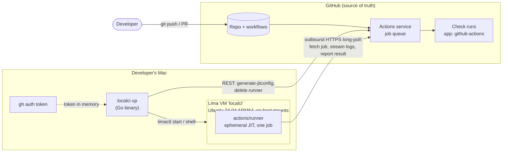
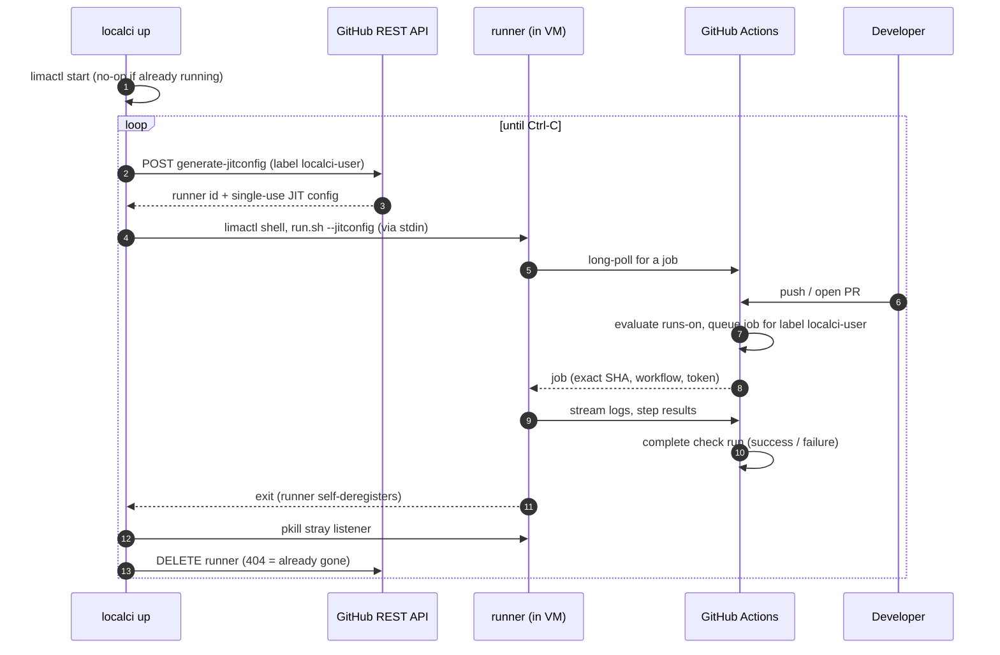
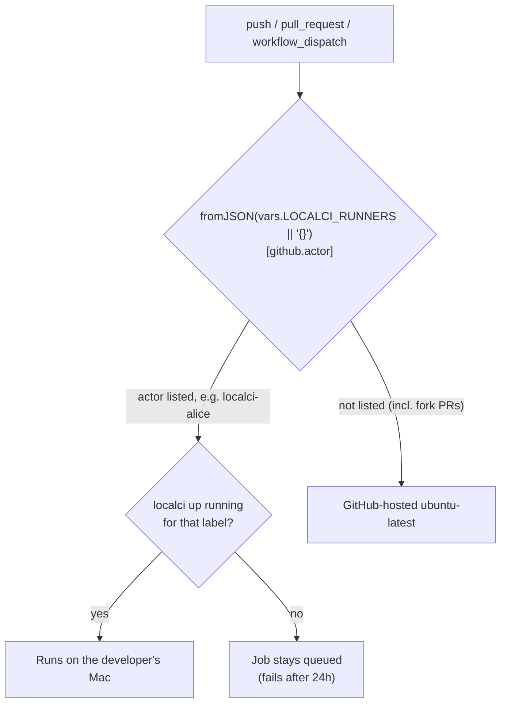

# Architecture

## Phase 1: components



| Concern | Owner |
|---|---|
| Event detection, job dispatch, commit identity | GitHub Actions (runner long-poll) |
| Workflow parsing and execution | official `actions/runner` |
| Check status and logs | GitHub Actions (the job's own check run) |
| VM lifecycle, runner registration loop | `localci` (`internal/runner`) |
| GitHub API calls | `localci` (`internal/github`) |
| Auth | `GH_TOKEN` or `gh auth token` (repo admin), in memory only |

Everything goes over outbound HTTPS. There are no inbound ports, no webhooks and no LocalCI backend.

## Job lifecycle



## Routing



`runs-on` is evaluated when the job is queued. Opt-in jobs use:

```yaml
runs-on: ${{ fromJSON(vars.LOCALCI_RUNNERS || '{}')[github.actor] || 'ubuntu-latest' }}
```

`LOCALCI_RUNNERS` is a repository variable mapping a GitHub login to a runner label, for example `{"alice":"localci-alice"}`. Each job runs exactly once, on either a hosted or a local runner, so duplicate or conflicting checks can't happen.

For `pull_request`, the runner tests GitHub's merge ref (`refs/pull/N/merge`), and the check appears on the PR head SHA. That's the same as hosted runners (research 002).

## Failure behaviour

- **Laptop offline or asleep:** the job stays queued and fails after 24h. No fallback in Phase 1.
- **Agent killed mid-job:** GitHub fails the job. On shutdown, cleanup kills the listener in the VM and deletes the registration.
- **Registration fails** (network, API): logged, then retried every 10s.
- **Cancellation and timeouts:** handled by the runner itself (`timeout-minutes`, cancel button).

## Not in Phase 1

- Checks API and GitHub App (Phase 2/3)
- A fresh VM per job (Phase 4)
- Hosted fallback when offline
- Docker inside the VM (pending decision)
- Parallel runners per `localci up`
