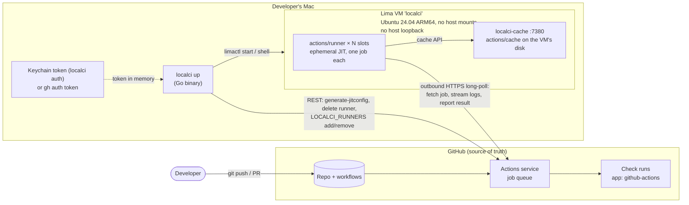
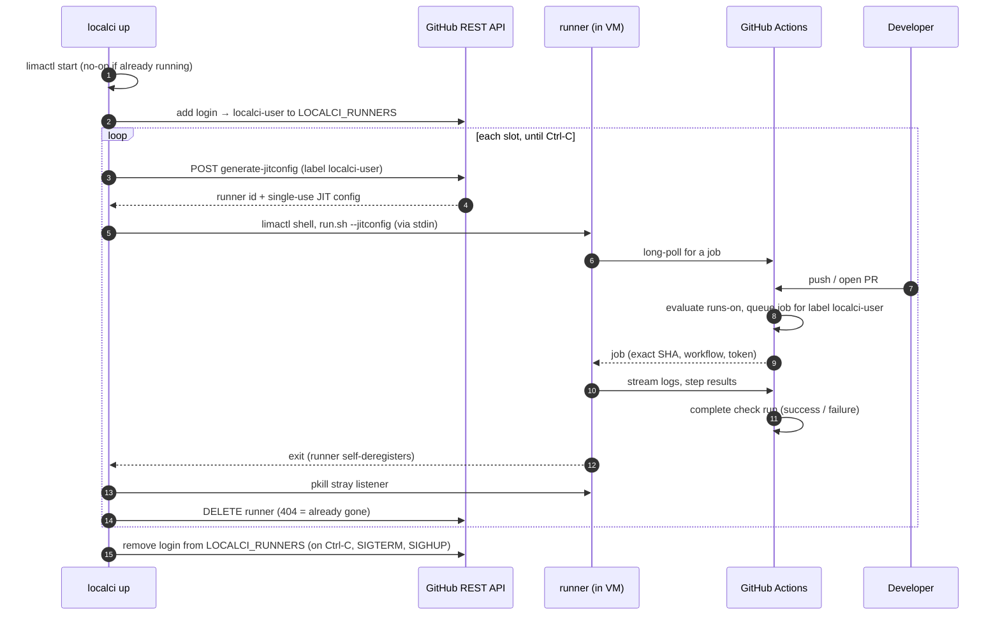
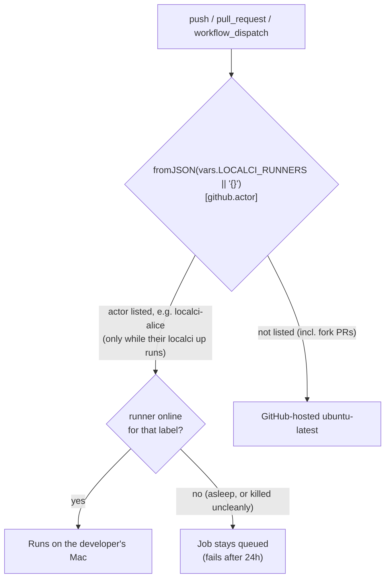
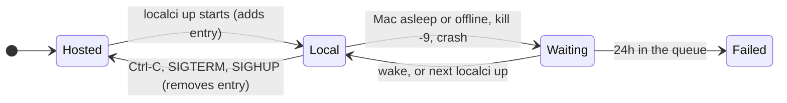
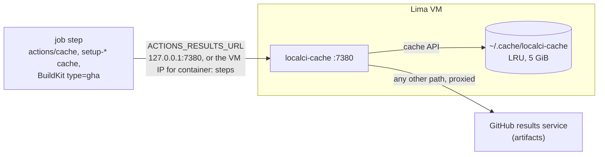
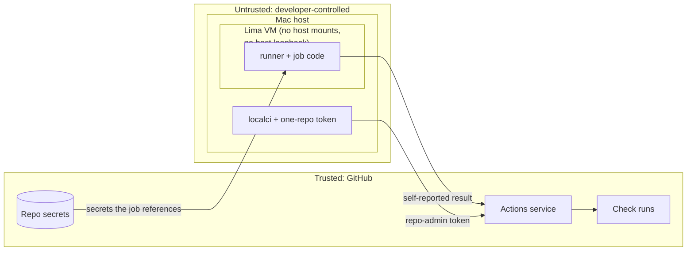

# Diagrams

Every LocalCI diagram in one place. The prose behind them is in [architecture](architecture.md) and [security](security.md).

- [Components](#components)
- [Job lifecycle](#job-lifecycle)
- [Routing](#routing)
- [Where your jobs go](#where-your-jobs-go)
- [Local Actions cache](#local-actions-cache)
- [Trust boundary](#trust-boundary)
- [One runner vs several](#one-runner-vs-several)

## Components

What runs where. All traffic is outbound HTTPS from the Mac: no inbound ports, no webhooks, no LocalCI server.

## Job lifecycle

One runner slot, from `localci up` to Ctrl-C. With `-runners N`, N slots run the loop at once.

## Routing

How GitHub picks a runner for a job that has the LocalCI `runs-on` line.

## Where your jobs go

Depending on what `localci up` is doing.

## Local Actions cache

Cache calls stay in the VM. Everything else, such as artifacts, goes on to GitHub.

## Trust boundary

What crosses into the developer's control, and what comes out of it.

## One runner vs several

ripgrep's six CI jobs, in seconds after the run was queued. Hosted gives each job its own machine, so the workflow takes as long as its slowest job. One local runner does the jobs one after another. Three runners close the gap.

```mermaid
gantt
  dateFormat X
  axisFormat %M:%S
  section Hosted, 6 machines
    test         :3, 75
    fuzz_testing :3, 63
    wasm         :3, 33
    benches      :3, 31
    docs         :3, 26
    rustfmt      :3, 11
  section Local, 1 runner
    docs         :3, 13
    fuzz_testing :16, 30
    benches      :33, 42
    rustfmt      :45, 50
    test         :54, 84
    wasm         :87, 97
  section Local, 3 runners
    rustfmt      :2, 13
    docs         :2, 15
    wasm         :2, 19
    benches      :17, 50
    test         :19, 63
    fuzz_testing :23, 49
```

