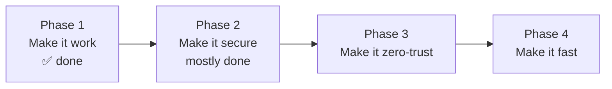

# Roadmap

| Phase | Goal | Done | Next |
|---|---|---|---|
| 1. Work | Existing jobs run on a Mac and produce the real check | JIT runner in Lima, `localci setup` and `up`, Docker, `services:` and `container:` jobs, parallel runners, hosted fallback while stopped, sleep and network recovery | launchd agent, a real lid-close test, Homebrew tap and release builds, amd64 emulation if a real workflow needs it |
| 2. Secure | Secrets and deploys never reach a laptop by accident | VM blocked from the Mac's loopback, warnings for routed jobs that use secrets, environments or OIDC, warning for a read-write `GITHUB_TOKEN`, one-repo token in the Keychain | decide whether to offer a fresh VM per job: measured at about 10s extra per job, all of it boot ([why it's a trade-off](faq.md#is-the-vm-fresh-for-every-job)) |
| 3. Zero-trust | Others can rely on a local result | — | re-run a random sample of local jobs on hosted runners and flag disagreements; signed results in a transparency log |
| 4. Fast | Faster than hosted, measured | local `actions/cache` | VM warm start, bigger VMs for many-job workflows, CPU, memory and battery sampling, warn when a runner self-update undoes the cache patch |
