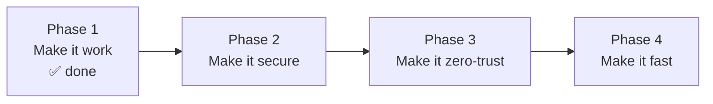

# Roadmap

Full goals per phase: `docs/brief.md` §2. Current tasks: `docs/progress.md`.

| Phase | Goal | Items |
|---|---|---|
| 1. Work ✅ | Existing jobs run on a Mac and produce the real check | native JIT runner in Lima, `localci setup`/`up`, Docker and `services:`, parallel runners, hosted fallback while stopped, sleep/network behaviour ([progress](progress.md)) |
| 1, leftovers | | launchd agent, real lid-close test, amd64 emulation if needed, Homebrew tap |
| 2. Secure | Secrets and deploys never reach a laptop | secrets policy (route jobs that use secrets or environments to hosted runners), evaluate OIDC. Non-admin auth only when someone needs it ([ADR 0002](decisions/0002-repo-admin.md)) |
| 3. Zero-trust | Others can rely on a local result | ideas to revisit: optimistic verification (re-run a random sample of local jobs on hosted runners and flag disagreements), signed results in a transparency log (Sigstore, in-toto) |
| 4. Fast | Faster than hosted, measured | warm caches, VM warm start, a fresh VM per job, host CPU/memory/battery sampling |
