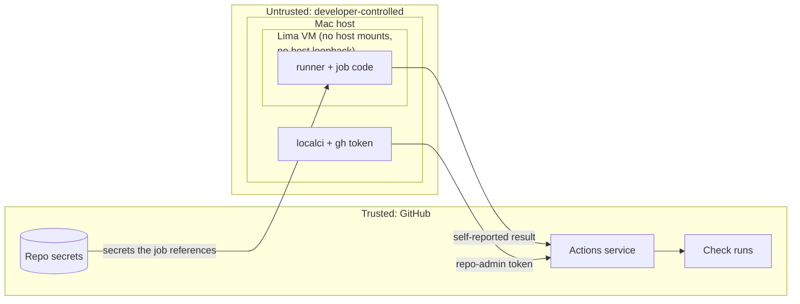

# Security

## Threat model (Phase 1)

The developer controls the Mac, the VM, the runner and localci. Anything that runs locally can be observed or altered by them.

Everything that crosses into the untrusted box is exposed to the developer, and everything that comes out of it is the developer's word. The VM boundary protects the **developer's** host from job code (that's why there are no host mounts, and why the VM can't reach services on the Mac's `127.0.0.1`). It does not protect jobs or secrets from the developer.

## What Phase 1 does **not** guarantee

- **Result integrity.** A local runner can report success for a failing commit. GitHub's branch protection can't tell a self-hosted runner's result from a hosted one. A green check from LocalCI means "this developer's machine says it passed".
- **Secret confidentiality.** Every secret a routed job references is delivered to the local runner. A VM doesn't hide it from the host owner.
- **Clean environment.** The VM persists between jobs, so state can leak from one job to the next.
- **Docker inside the VM.** Job code is in the `docker` group, which makes it root inside the VM. That changes nothing for the host, because the VM is the boundary and has no host mounts. It does mean one job can tamper with the VM for the next.

## Invariants

- The VM can't reach services that listen on the Mac's `127.0.0.1`. `setup-vm.sh` sets `networkOpts.hostLoopback: false` on Lima 2.3 and later ([research 005](research/005-phase2-security.md), F1). Services the Mac binds to all interfaces stay reachable through its LAN IP.

- The local cache server listens on the VM's port 7380, which Lima `--plain` doesn't forward to the Mac. It decodes but doesn't verify job tokens: it only serves the developer's own jobs, and anything that reaches it is already in the VM. It keeps GitHub's branch scoping, so a branch can't overwrite what the default branch restores ([research 006](research/006-local-actions-cache.md)).
- Tokens are read at runtime (`GH_TOKEN` or `gh auth token`) and are never logged, printed, or written to disk by localci.
- The runner's JIT config is single-use and is passed directly to the runner process.
- Don't route jobs that reference protected secrets to local runners.
- **Public repos:** routing by `github.actor` keeps fork PRs on hosted runners. Never give a local runner a label that untrusted actors can target.

## Deferred

Keeping secret-using jobs off local runners (Phase 2). Non-admin auth, until someone needs it ([ADR 0002](decisions/0002-repo-admin.md)). Independent verification (Phase 3).
